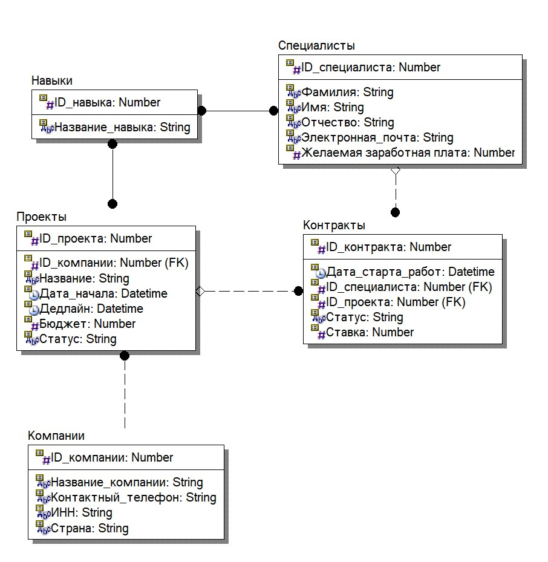

# Бизнес логика

**Назначение проекта** Проект представляет собой веб-платформу для аутсорс-взаимодействия между IT-компаниями и независимыми специалистами. Основная цель системы — автоматизировать процесс публикации контрактных задач, отбора релевантных исполнителей под конкретный стек технологий и фиксации договоренностей в виде контрактов.

**Участники системы**

- **Компания (Заказчик):** регистрирует организацию, размещает проектные задачи с указанием временных рамок, бюджета и требуемого технологического стека, выбираемого из стандартизированного справочника навыков.

- **Специалист (Исполнитель):** формирует профессиональный профиль с указанием ключевых компетенций из справочника и зарплатных ожиданий, просматривает открытый каталог проектов и подает заявки на участие.

**Концепция взаимодействия** В основе платформы заложена входящая модель подбора («от проекта»):

- **Отсутствие холодного поиска:** в системе намеренно исключены открытый каталог специалистов и поиск по резюме со стороны компаний. Это снижает нецелевую нагрузку на исполнителей и фокусирует отбор только на заинтересованных кандидатах.

- **Инициатива со стороны исполнителя:** компания формирует требования к проекту, а специалист самостоятельно оценивает соответствие своему стеку и ожиданиям по ставке, после чего отправляет отклик.

- **Заключение сделки:** компания рассматривает поступившие отклики, сопоставляет профили кандидатов с требованиями задачи и утверждает подходящего исполнителя, инициируя заключение контракта на выполнение работ.

# Функциональные требования
#### Управление профилями и аутентификация

1. **Регистрация и разделение ролей:**

    - Система должна поддерживать два непересекающихся типа учетных записей: «Компания» и «Специалист».
    - При регистрации Компании обязательными полями являются: Название, ИНН (с валидацией формата), Контактный телефон и Страна.
    - При регистрации Специалиста обязательными полями являются: ФИО, Электронная почта и Желаемая заработная плата.

2. **Профиль специалиста:**

    - Специалист должен иметь возможность выбрать один или несколько навыков из нормализованного справочника «Навыки».
    - Специалист может обновлять стек и желаемую ставку в любой момент.

#### Управление проектами (для Компании)

1. **Публикация проекта:**

    - Компания может создать проект, заполнив Название, Дату начала, Дедлайн, Бюджет и привязав требования к стеку из справочника «Навыки».
    - Система должна валидировать даты: `Дедлайн` не может быть раньше `Даты_начала`.

2. **Жизненный цикл проекта:**

    - Проект должен поддерживать переходы состояний через атрибут `Статус`: `Черновик` $\to$ `Опубликован` $\to$ `В работе` $\to$ `Завершен` / `Отменен`.
    - В открытом каталоге отображаются только проекты в статусе `Опубликован`.

#### Поиск и отклики (для Специалиста)

1. **Каталог вакансий/проектов:**

    - Система должна предоставлять публичный список открытых проектов с пагинацией и фильтрацией по:
        - Навыкам (поиск проектов, где требуется хотя бы один или все выбранные навыки);
        - Минимальному бюджету;
        - Дедлайну.

2. **Подача отклика:**
    - Авторизованный специалист может отправить заявку на опубликованный проект.
    - Система должна блокировать повторный отклик от одного и того же специалиста на один и тот же проект (ограничение уникальности `ID_специалиста + ID_проекта`).

#### Контрактация и управление сделкой

1. **Обработка откликов компанией:**

    - Компания-владелец проекта видит список откликнувшихся специалистов с их стеком и зарплатными ожиданиями.
    - Компания имеет право перевести отклик в статус `Одобрен` или `Отклонен`.

2. **Создание контракта:**

    - При подтверждении специалиста создается запись в таблице `Контракты` с фиксацией `Даты старта работ`.
    - Если на проект набран нужный лимит исполнителей, статус проекта автоматически переходит в `В работе`.
    - Система запрещает специалисту подавать новые отклики, если у него есть незавершенный контракт (опциональное бизнес-правило).

# Архитектура базы данных

Ниже представлена концептуальная схема данных (ER-диаграмма) платформы аутсорса:

